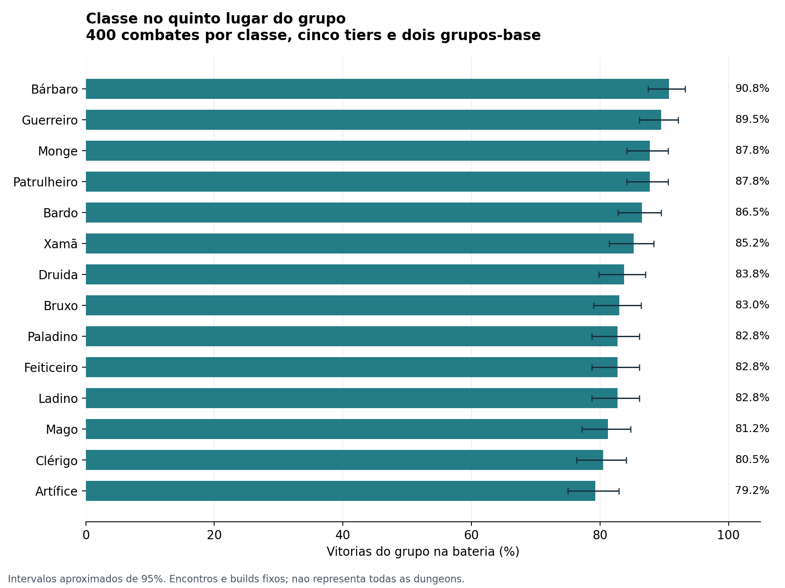
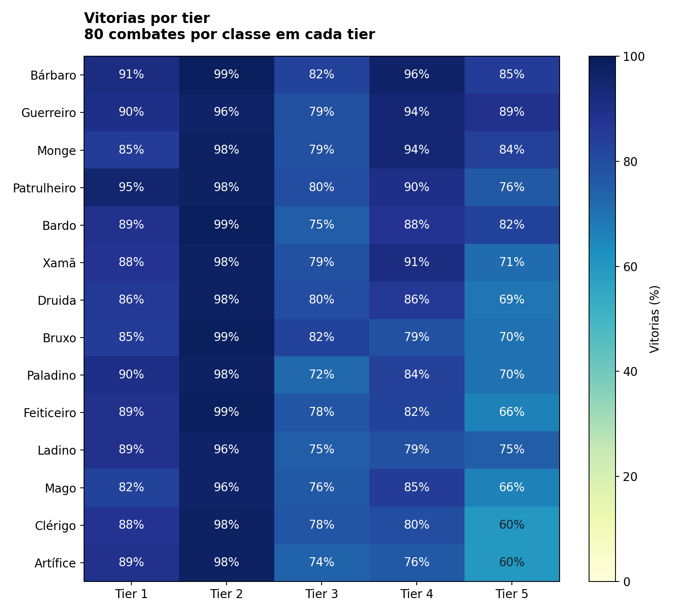

# Comparacao das classes em combate

Codigo analisado: `22b3481a18416f23d553da18cbd6a6f1a078a226`. Bateria principal de **5.600 combates reais do motor**, com 400 confrontos por classe, e checagem adicional de **1.120 combates em trios**. Total: **6.720 combates confirmatorios**.

## Resultado

Cada valor e a taxa de vitoria do grupo quando a classe ocupa o quinto lugar. As quatro primeiras posicoes permanecem fixas. A media atribui o mesmo peso aos cinco tiers, aos dois grupos-base e aos quatro encontros.

| Classe | T1 | T2 | T3 | T4 | T5 | Media | HP restante do grupo |
|---|---|---|---|---|---|---|---|
| Bárbaro | 91% | 99% | 82% | 96% | 85% | 90.8% | 58.1% |
| Guerreiro | 90% | 96% | 79% | 94% | 89% | 89.5% | 59.3% |
| Monge | 85% | 98% | 79% | 94% | 84% | 87.8% | 57.0% |
| Patrulheiro | 95% | 98% | 80% | 90% | 76% | 87.8% | 55.4% |
| Bardo | 89% | 99% | 75% | 88% | 82% | 86.5% | 57.1% |
| Xamã | 88% | 98% | 79% | 91% | 71% | 85.2% | 59.0% |
| Druida | 86% | 98% | 80% | 86% | 69% | 83.8% | 54.2% |
| Bruxo | 85% | 99% | 82% | 79% | 70% | 83.0% | 55.1% |
| Paladino | 90% | 98% | 72% | 84% | 70% | 82.8% | 53.8% |
| Feiticeiro | 89% | 99% | 78% | 82% | 66% | 82.8% | 53.7% |
| Ladino | 89% | 96% | 75% | 79% | 75% | 82.8% | 52.1% |
| Mago | 82% | 96% | 76% | 85% | 66% | 81.2% | 52.5% |
| Clérigo | 88% | 98% | 78% | 80% | 60% | 80.5% | 52.0% |
| Artífice | 89% | 98% | 74% | 76% | 60% | 79.2% | 51.5% |





## Efeito da composicao

Grupo A: Guerreiro, Patrulheiro, Mago e Clerigo, mais a classe avaliada.

Grupo B: Barbaro, Ladino, Feiticeiro e Xama, mais a classe avaliada.

Os valores de cura sao do grupo completo e contabilizam somente cura efetiva. Rodadas considera apenas confrontos vencidos. HP restante e a fracao do HP maximo atual dos personagens que continuam no combate, depois dos efeitos de condicoes; nao e usado para definir superioridade entre classes. Estes valores nao medem o DPS nem a cura individual da quinta classe.

| Classe | Vitorias A | Vitorias B | Cura efetiva do grupo | Rodadas nas vitorias |
|---|---|---|---|---|
| Bárbaro | 89.0% | 92.5% | 16.3 | 3.6 |
| Guerreiro | 86.5% | 92.5% | 25.1 | 3.4 |
| Monge | 88.0% | 87.5% | 14.0 | 3.7 |
| Patrulheiro | 88.5% | 87.0% | 15.2 | 3.5 |
| Bardo | 85.0% | 88.0% | 29.2 | 4.2 |
| Xamã | 87.0% | 83.5% | 26.6 | 3.7 |
| Druida | 83.0% | 84.5% | 15.1 | 3.5 |
| Bruxo | 82.0% | 84.0% | 14.6 | 3.4 |
| Paladino | 80.5% | 85.0% | 30.6 | 3.8 |
| Feiticeiro | 84.0% | 81.5% | 13.5 | 3.2 |
| Ladino | 81.0% | 84.5% | 15.8 | 3.6 |
| Mago | 78.0% | 84.5% | 13.5 | 3.3 |
| Clérigo | 81.0% | 80.0% | 25.3 | 3.9 |
| Artífice | 80.5% | 78.0% | 16.9 | 3.5 |

## Encontros

As fichas das criaturas vem do bestiario, sem multiplicar HP ou dano. Sao encontros de teste, com peso igual, sem pretensao de reproduzir a frequencia das salas em producao.

| Tier | Cenario | Criaturas | Vitorias de todas as classes |
|---|---|---|---|
| 1 | bando | 6x Bandido | 100.0% |
| 1 | fisico | 4x Bugbear | 60.7% |
| 1 | controle | 4x Carniçal | 100.0% |
| 1 | chefe | 2x Ogro | 92.1% |
| 2 | bando | 4x Doppelganger | 100.0% |
| 2 | fisico | 3x Urso-Coruja | 100.0% |
| 2 | controle | 2x Múmia | 100.0% |
| 2 | area | 2x Crânio Flamejante | 90.4% |
| 3 | bando | 6x Ogro | 100.0% |
| 3 | fisico | 2x Gigante da Pedra | 18.2% |
| 3 | controle | 2x Devorador de Mentes | 100.0% |
| 3 | area | 1x Dragão Verde Jovem | 92.9% |
| 4 | bando | 4x Troll | 100.0% |
| 4 | fisico | 1x Gigante da Tempestade | 74.3% |
| 4 | controle | 1x Observador | 100.0% |
| 4 | area | 1x Dragão Branco Adulto | 69.6% |
| 5 | bando | 3x Gigante do Gelo | 53.2% |
| 5 | fisico | 1x Balor | 73.2% |
| 5 | controle | 1x Cavaleiro da Morte | 88.2% |
| 5 | area | 1x Dragão Vermelho Adulto | 77.9% |

## Como foi medido

- O comparador instancia o cog verdadeiro, usa `usar_habilidade`, `atacar` e `_avancar`, e resolve iniciativa, ameaca, passivas, reacoes, condicoes e custo de levantar com o codigo do jogo.
- Somente mensagens, renderizacao e recompensas posteriores ao confronto sao desligadas. O Discord e substituido pelos dubles de teste do projeto.
- Cada confronto usa SQLite em memoria. Nenhum banco do servidor e acessado.
- Todos comecam com HP e recursos completos, sem equipamento, pocoes ou condicoes anteriores. Niveis 1, 3, 5, 7 e 9, conforme `rules.nivel_do_tier`.
- As escolhas e a prioridade automatica de acoes vem de `tools/simular_balanceamento.py`; requisitos, usos e alvos validos sao conferidos pelo bot. As escolhas completas estao em `metodologia.json`.
- Mesmo conjunto de sementes por cenario para todas as classes. Reproducibilidade conferida repetindo uma celula completa.
- Limite de 30 rodadas: **0 combates atingiram o limite**.
- Os intervalos do grafico sao aproximacoes binomiais de 95%, conservadoras para esta mistura fixa de encontros. `diferencas_pareadas.csv` contem bootstrap pareado por semente e estratificado pelos 40 cenarios, com 5.000 reamostragens.

## Checagem em trios

Mais 1.120 combates, nos mesmos encontros dos tiers 3 e 5: Guerreiro + Clerigo + candidato (C), ou Barbaro + Mago + candidato (D). Sao 80 combates por classe, 40 em cada tier. A amostra e menor e os intervalos sao mais largos. As medias desta tabela usam apenas os tiers 3 e 5; elas nao sao diretamente comparaveis a media dos cinco tiers da bateria principal.

| Classe | Tier 3 | Tier 5 | Media dos dois tiers |
|---|---|---|---|
| Guerreiro | 47.5% | 35.0% | 41.2% |
| Bárbaro | 47.5% | 30.0% | 38.8% |
| Monge | 50.0% | 22.5% | 36.2% |
| Xamã | 45.0% | 25.0% | 35.0% |
| Patrulheiro | 37.5% | 25.0% | 31.2% |
| Bruxo | 40.0% | 15.0% | 27.5% |
| Feiticeiro | 40.0% | 15.0% | 27.5% |
| Druida | 40.0% | 15.0% | 27.5% |
| Paladino | 40.0% | 12.5% | 26.2% |
| Mago | 37.5% | 12.5% | 25.0% |
| Artífice | 35.0% | 7.5% | 21.2% |
| Clérigo | 35.0% | 7.5% | 21.2% |
| Bardo | 27.5% | 10.0% | 18.8% |
| Ladino | 25.0% | 12.5% | 18.8% |

## Limites para interpretar

Esta e uma comparacao de combate isolado, com builds e uma politica automatica especificas. Nao mede desempenho de todos os arquetipos, jogadas otimas, testes de pericia, economia, equipamento ou desgaste entre salas. As vantagens de exploracao de classes como Bardo e Ladino ficam fora da conta.

Uma diferenca pequena na media nao basta para declarar uma classe superior. Confira os dois grupos-base, a distribuicao por tier e os intervalos em `diferencas_pareadas.csv` antes de decidir ajustes.

Os intervalos pareados sao por comparacao, sem correcao por comparacoes multiplas; servem para orientar a investigacao do balanceamento.

Em `combates.csv`, `dano_efetivo` e a diferenca entre o HP inicial e final dos inimigos; regeneracao pode reduzir esse numero. Ele nao representa dano bruto total. `acoes` registra as acoes que passaram pela fila; magias rapidas resolvidas fora da fila nao entram nesse contador.

## Reproducao e arquivos

Execute o script com acesso ao mesmo checkout do repositorio. Configure `BOT_INCURSOES_REPO` se o caminho for diferente.

```bash
BOT_INCURSOES_REPO=/caminho/Bot-Incursoes BOT_INCURSOES_RESULTADOS=./resultados python comparar_classes_jogo.py --repeticoes 10 --modos A B --processos 2 --nome comparacao
```

Arquivos: `combates.csv` (5.600 registros), `resumo_classes.csv`, `por_encontro.csv`, `diferencas_pareadas.csv`, `metodologia.json` e `comparacao.jsonl`.

Os dados adicionais dos trios estao em `combates_trios.csv`, `resumo_trios.csv` e `trios.jsonl`. Para reproduzir:

```bash
BOT_INCURSOES_REPO=/caminho/Bot-Incursoes BOT_INCURSOES_RESULTADOS=./resultados python comparar_classes_jogo.py --tiers 3 5 --repeticoes 5 --modos C D --processos 2 --nome trios
```
